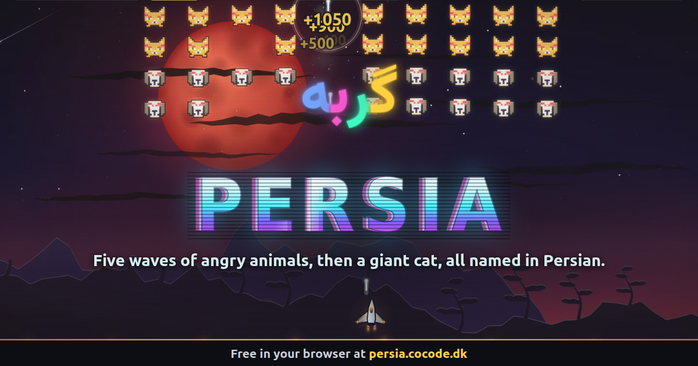

# Persia

An arcade shooter for the browser. Five waves of angry animals come at you (dogs, cats, horses,
cows, fish, birds and rabbits), and then a giant cat. Spread shot, laser, rapid fire, shield and
smart bombs drop along the way, and combos push the score up.

The animals are named in Persian. When a species arrives in a wave, a voice says its name once and
the word lights up over the fight for about a second, each letter in its own colour. The menus and
the score are in English. The level opens like a film, with the lights going down, and ends with
the seven animals parading past, each named one more time. Then your score, and "Again".

[](https://persia.cocode.dk)

## Play

**[persia.cocode.dk](https://persia.cocode.dk)**: free, nothing to install. It is made for a laptop
or desktop with a keyboard and mouse. Play with the sound on, because the names are spoken.

## Controls

| Action | Keyboard | Mouse |
|---|---|---|
| Move | Arrows or WASD | the ship follows the pointer |
| Fire (hold for auto-fire) | Space | left button |
| Smart bomb | B or Shift | right button |
| Pause | P or Esc | |
| Mute | M | |
| Confirm in menus | Enter | click |

You have three lives. Lose them all and you start again from wave 1. The opening plays on the first
Play after the page loads, and any key skips it once it has run for a second.

## Run locally

Plain HTML, CSS and JavaScript modules: no dependencies, no build step, no network requests at
runtime. Every URL is relative, so the folder also works under a sub-path.

```sh
git clone https://github.com/cocodedk/persia-game.git
cd persia-game
python3 -m http.server 8000   # then open http://localhost:8000/
```

Any static file server works. Opening `index.html` straight from disk does not, because browsers
block ES modules on `file://`.

## Tests and layout

```sh
npm test
```

Node 22 or newer, nothing to install. Persia started as a fork of
[Invaders](https://github.com/cocodedk/invaders) and was cut down to what this one level runs.

| Path | What lives there |
|---|---|
| `src/core/` | the simulation: fixed 1/60 s steps in a 1920 x 1080 world, the waves, the giant, weapons and scoring |
| `src/fx/` | effects state: particles, camera shake, slow motion |
| `src/ui/` | everything that touches the browser: drawing, sound, the voice, the word on screen, the menus |
| `src/data/pack.js` | the word pack: each Persian word, the clip it plays, the letter colours and the font |
| `src/main.js` | boot and the frame loop |
| `public/audio/` | the twelve voice clips and `manifest.json` |
| `public/fonts/` | Vazirmatn Bold, the face the words are set in |
| `test/` | `node:test` suites for core, fx, ui and the pack, plus checks on the repo itself |

`src/core/` and `src/fx/` never touch the browser: randomness comes from a seeded generator and time
from the step, so the tests can run the game in Node. The repo checks keep every code file under
200 lines, the game free of external URLs, every Persian character inside `src/data/pack.js`, and
every export in use. The design spec and the build plan are in `docs/superpowers/`.

## The voice clips

Persia plays twelve clips: the seven animal names, and the numbers one to five, said as each wave
starts. They come from the [Danish-Persian-Lessons](https://github.com/cocodedk/Danish-Persian-Lessons)
repository. Each was synthesised with the Piper voice `fa_IR-ganji-medium` and then approved by a
native Persian reviewer, and only approved clips were copied (`scripts/lift-clips.mjs` refuses any
other). `public/audio/manifest.json` keeps each clip's provenance: its source ID and SHA-256, its
length, the text it was synthesised from, the voice model and its checksum, the engine version,
who reviewed it and its licence.

The game never synthesises speech itself, and no clip goes in without a review.

## Licences

- Code: Apache-2.0, see [LICENSE](LICENSE).
- Vazirmatn, by Saber Rastikerdar: SIL Open Font License 1.1, see
  [public/fonts/OFL.txt](public/fonts/OFL.txt).
- Voice clips: "MIT model; CC0 dataset", as the manifest records for every clip.

## Contributing

See [CONTRIBUTING.md](CONTRIBUTING.md). Security reports go through [SECURITY.md](SECURITY.md).

## Author

**Babak Bandpey**: [cocode.dk](https://cocode.dk) | [LinkedIn](https://linkedin.com/in/babakbandpey) | [GitHub](https://github.com/cocodedk)

© 2026 [Cocode](https://cocode.dk)
